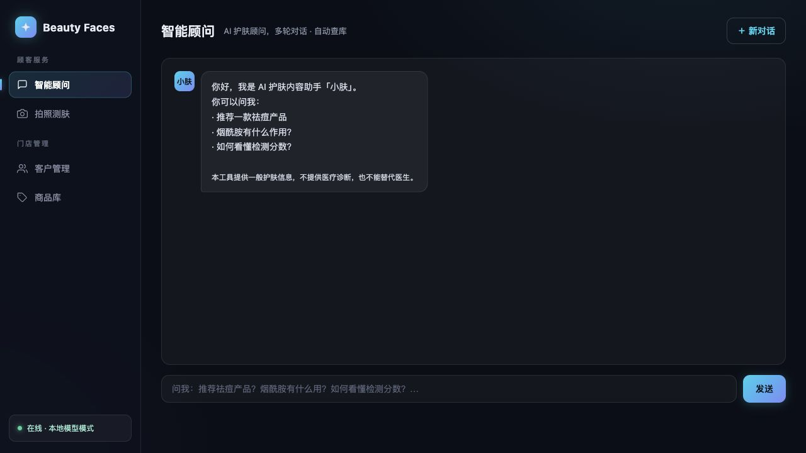
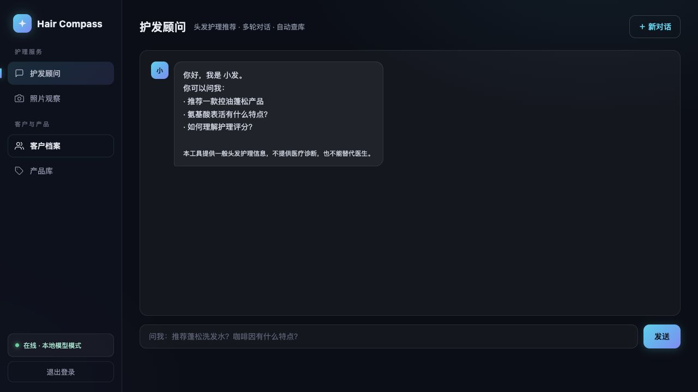

# Beauty Faces

本地优先的 AI 面部皮肤外观分析与护肤产品推荐 MVP。

核心流程是：用户上传面部照片，视觉模型给出一般性的皮肤外观观察；门店侧结合结构化检测指标、规则评分、成分知识和商品库生成推荐；用户还可以通过 LangGraph 智能体继续追问。默认使用本地 Ollama，数据不依赖外部 SaaS。

> 本项目是工程 MVP，不是医疗产品。不提供疾病诊断，也不能替代医生。仓库不包含真实客户数据、训练数据集或第三方商品图片。



## 项目定位

这是一个以护肤为主线的**单租户、单节点、可自行部署的垂直推荐 MVP**，已经具备完整闭环：面部照片观察、结构化皮肤指标、确定性推荐、成分与商品检索、多轮对话、客户管理、权限隔离、合成样例、测试和部署文件。

它还不是成熟 SaaS：没有个人账号、多租户、审计日志、计费、数据迁移平台或生产级共享限流；视觉模型也没有临床验证。适合作为产品验证、作品集和后续行业版本的技术底座，不适合直接承载医疗诊断。

底层采用 profile 配置，护肤主场景位于 `app/profiles/skin_care/`。仓库额外保留 `hair_care`，只用于证明同一套代码可以切换字段和领域，不是当前产品主线。

## 核心能力

- 面部照片上传与一般性皮肤外观观察
- 皮肤维度、指标权重、重点排序和护肤产品匹配
- 护肤成分知识库、商品目录和客户检测报告
- 配置驱动的场景定义，新领域不需要修改核心 Python 或前端代码
- 默认 `skin_care` 护肤主场景，`hair_care` 仅作为扩展示例
- Ollama 文本/视觉模型，DeepSeek 可选作文本模型
- LangGraph 多轮对话、工具调用和 SQLite 会话检查点
- 加权维度评分、方向配置、重点维度排序和产品匹配
- 动态客户字段、筛选条件、商品属性、警示规则和提示词
- 本地 SQLite 数据，按 profile 使用独立数据库文件
- 管理登录使用签名 HttpOnly Cookie，不把口令存入浏览器存储
- 匿名聊天按签名会话作用域隔离
- Docker 非 root 运行、健康检查、本机端口、环境变量和 CI

## 快速启动

### 1. 准备模型

```bash
ollama pull qwen3.5:4b
ollama pull qwen3-vl:8b
```

如果模型标签已变化，修改 `.env` 中的 `LLM_MODEL` 或 `VLM_MODEL`。

### 2. 配置

```bash
cp .env.example .env
```

将两个占位值替换为随机值：

```bash
openssl rand -hex 24
openssl rand -base64 48
```

默认使用护肤场景：

```dotenv
APP_PROFILE=skin_care
```

默认无需修改 `APP_PROFILE`。如需查看架构扩展示例，可临时切换：

```dotenv
APP_PROFILE=hair_care
```

### 3. Docker 启动

```bash
docker compose up --build
```

打开 <http://127.0.0.1:8000>。

Docker 使用命名卷保存运行数据。需要访问宿主机 Ollama 时，默认地址为 `http://host.docker.internal:11434`。

### 4. 本地 Python 启动

```bash
uv venv
uv pip install -r requirements-dev.txt
export ADMIN_TOKEN="$(openssl rand -hex 24)"
export SESSION_SECRET="$(openssl rand -base64 48)"
export APP_PROFILE=skin_care
export SEED_DEMO=1
export DATA_DIR="./data"
python -m app.seed
uvicorn app.main:app --host 127.0.0.1 --port 8000
```

护肤主场景的数据文件是 `data/skin_care.db`。扩展示例使用 `data/hair_care.db`。

## 配置

| 变量 | 必填 | 默认值 | 说明 |
|---|---:|---|---|
| `ADMIN_TOKEN` | 是 | 无 | 管理口令，至少 16 个字符 |
| `SESSION_SECRET` | 是 | 无 | Cookie 签名密钥，至少 32 个字符 |
| `APP_PROFILE` | 否 | `skin_care` | `app/profiles/` 下的场景目录 |
| `DATA_DIR` | 否 | `./data` | 数据库与检查点目录 |
| `SEED_DEMO` | 否 | `0` | 为 `1` 时导入 profile 的合成样例 |
| `OLLAMA_URL` | 否 | `http://localhost:11434` | Ollama 地址 |
| `LLM_MODEL` | 否 | `qwen3.5:4b` | 文本与工具调用模型 |
| `VLM_MODEL` | 否 | `qwen3-vl:8b` | 图片观察模型 |
| `DEEPSEEK_API_KEY` | 否 | 空 | 设置后文本请求改走外部 DeepSeek |
| `COOKIE_SECURE` | 否 | `false` | HTTPS 部署时设为 `true` |
| `APP_BIND` | 否 | `127.0.0.1` | Docker 映射地址 |

`OLLAMA_URL` 指向远程主机时，图片和文本同样会离开本机。只有确认该服务受信任后，“本地模型模式”才成立。

## 场景配置

一个场景位于 `app/profiles/<profile-id>/`：

```text
profile.json          品牌、文案、字段、维度、权重、方向、匹配数量、警示规则
system_prompt.txt     智能体行为和工具使用约束
report_prompt.txt     结构化报告模板，支持 {info}、{conclusions}
vlm_prompt.txt        可选视觉观察提示词
customers.sample.json 合成客户样例
products.sample.json  合成产品目录
knowledge.json        成分或领域知识条目
```

推荐逻辑现在是通用的：

1. `profile.json` 声明客户字段和评分项。
2. `rules.py` 按 item weight 计算维度分数。
3. `higher_is_better` 决定重点维度排序和颜色方向。
4. 每个维度的 `category` 对应产品分类。
5. `top_dimensions` 和 `products_per_dimension` 控制匹配数量。
6. `alerts` 可配置任意指标阈值提示，不再在代码里写死特定指标。

新增场景的完整步骤见 [场景配置指南](docs/PROFILE_GUIDE.md)。启动时会校验字段引用、维度、产品分类、样例和提示词；配置错误会直接给出明确错误，而不是运行到一半静默失效。

### 扩展性验证

`hair_care` 使用相同的前端、API、推荐引擎、认证和数据库层，只替换 profile 配置与样例数据。它的作用是证明架构不是护肤硬编码，而不是把项目定位成通用护发产品。



## 数据与仓库隔离

- 原始项目中的真实客户资料、Word 报表、训练数据集、数据库、聊天检查点和品牌商品图均未复制。
- 每个场景只包含合成客户与合成产品，图片统一使用 [通用占位图](app/static/product-placeholder.svg)。
- 每个 profile 使用独立的 SQLite 数据库和检查点文件，不会和另一个场景共用数据。
- `data/` 只提交 `.gitkeep`；`.gitignore` 排除数据库、WAL、私有资料、第三方图片和密钥。
- 原始 Beauty-Faces 目录保持不变，真实数据仍留在原目录。

## 安全设计

- 管理口令和会话密钥缺失或过短时拒绝启动。
- 管理登录只下发签名 HttpOnly Cookie。
- `/api/customers*`、`/api/products*` 和 `/api/ai-report` 要求管理会话。
- 匿名智能体没有客户档案查询工具。
- 检查点线程 ID 使用匿名签名会话作用域和客户端 UUID。
- 请求大小、聊天长度、登录频率和 AI 调用频率均有限制。
- API 禁止缓存，并附带 CSP、`nosniff`、`DENY` 和权限策略响应头。
- 前端对动态文案、属性和服务端错误进行 HTML 转义。

## 发布改造记录

### 第一轮：安全发布

1. 在独立目录创建发布副本，隔离真实客户资料、数据库和研究素材。
2. 移除公开默认口令，加入安全配置校验和签名 HttpOnly Cookie。
3. 修复客户报告越权、会话串读、商品图片覆盖和结构化数据保存问题。
4. 加固请求大小、限流、安全头、错误处理和 HTML 转义。
5. 替换为合成客户、合成商品和通用占位图。
6. 增加 README、许可证、安全策略、环境模板、依赖锁、测试和 CI。

### 第二轮：从行业 Demo 到可扩展 MVP

1. 引入 `app/profile.py`，统一加载和校验场景配置。
2. 将代码中的护肤术语、维度、客户字段、分类、文案和提示词迁移到 profile。
3. 将固定平均分改为支持 item 权重的通用评分引擎。
4. 增加 `higher_is_better`、可配置关注数量、匹配数量、额外指标和阈值警示。
5. 将客户 `nature/ph/water/skin_age` 等专用字段改为通用 `attributes` JSON。
6. 将商品 `skin_type/ingredients` 改为通用的 `target/features/attributes`，并保留旧库迁移逻辑。
7. 将前端客户表单、筛选、详情指标、商品表格和文案改为读取 `/api/meta`。
8. 将客户和产品路由、数据库表、工具描述从护肤语义中解耦。
9. 每个 profile 使用独立数据库和检查点文件名。
10. 新增完整 `hair_care` 示例，CI 矩阵同时验证两个场景。
11. profile 启动时校验样例引用、分类、警示指标、提示词和推荐参数。

## 项目结构

```text
app/
  profile.py           profile 加载与校验
  profiles/            skin_care、hair_care 场景
  agent.py             LangGraph 智能体
  auth.py              签名 Cookie 与会话校验
  config.py            环境与 profile 配置
  db.py                通用 SQLite 数据访问与旧库迁移
  rules.py             加权评分与推荐
  tools.py             profile 无关的只读工具
  main.py              FastAPI API
  middleware.py        请求限制与安全响应头
  rate_limit.py        单进程限流
  static/              配置驱动前端
tests/                 API、权限和场景边界测试
.github/workflows/     skin_care / hair_care 双场景 CI
docs/                  截图和场景配置指南
```

## 测试

```bash
pip install -r requirements-dev.txt
ruff check app tests

APP_PROFILE=skin_care pytest
APP_PROFILE=hair_care pytest
```

测试使用临时数据目录和 profile 内的合成样例，不读取原始客户文件。当前 CI 会对两个场景分别运行完整 API 测试。

## 已知限制

- 这是单租户、单节点、单一管理角色的 MVP，不是多租户 SaaS。
- profile 配置能替换领域语义、字段、评分和样例，但复杂业务仍可能需要自定义表、审批流或外部系统连接器。
- SQLite 适合单实例；多实例部署需要 PostgreSQL、共享会话和集中式限流。
- 匿名 Cookie 和检查点尚无自动保留期限。
- 视觉模型输出没有临床验证，不能作为医疗诊断。
- 生产部署应增加 HTTPS、反向代理、个人账号、审计日志、备份和删除策略。

## 许可证

代码使用 [MIT License](LICENSE)。场景中的样例和占位图均为仓库自有合成内容；如引入第三方数据、图片或商标，请单独记录来源和许可。
